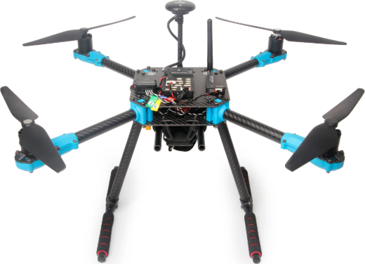
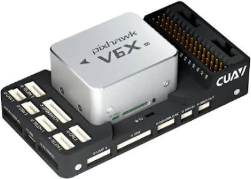
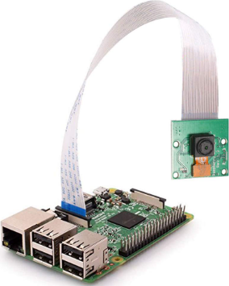
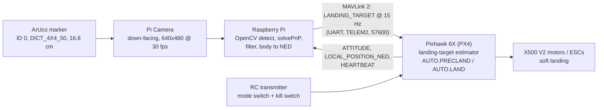
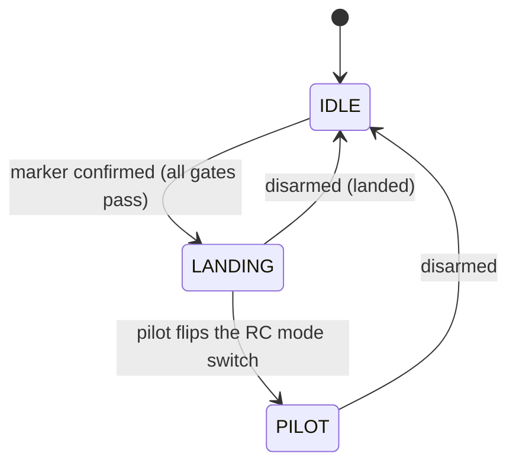
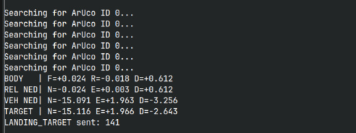

# ArUco Marker-Based Precision Landing

Autonomous precision landing for a **Holybro X500 V2** quadcopter with a **Pixhawk 6X** (PX4) flight controller. A down-facing Raspberry Pi camera detects an ArUco marker, estimates where it is, and streams that position to PX4 as MAVLink `LANDING_TARGET` messages. The pilot flies manually; once the marker is confirmed and it is safe, the script switches PX4 to precision-land mode and the drone lands itself.

---

## Hardware setup

| Component | Role |
|---|---|
| **Holybro X500 V2** | Quadcopter frame, motors, ESCs |
| **Pixhawk 6X** (PX4) | Flight controller, runs the precision-land logic |
| **Raspberry Pi + camera** | Companion computer: vision + MAVLink. Camera faces down, 640x480 at 30 fps (Picamera2) |
| **UART link** | Pi to Pixhawk **TELEM2** (`/dev/serial0`), 57600 baud, MAVLink 2 |
| **RC transmitter** | Manual flight, flight-mode switch, kill switch |
| **ArUco marker** | `DICT_4X4_50`, ID 0, 16.8 cm outer side (6 cells x 2.8 cm) |

<p align="center">
  
  
  
  
</p>

The camera image top is the aircraft front and the image right is the aircraft right.

---

## System architecture



How the pieces work together:

1. **Calibration** (`calibrate_charuco.py`): a 7x10 ChArUco board (24 mm squares, `DICT_5X5_100`) is captured from 20-30 varied views and the camera intrinsics and distortion are saved to `camera_calibration.npz`.
2. **Detection and pose** (`aruco_auto_land.py`): OpenCV's `ArucoDetector` with sub-pixel corner refinement finds ID 0. `solvePnP` (`SOLVEPNP_IPPE_SQUARE`) on the four corners of the known-size marker gives its position `(x, y, z)` and distance.
3. **Frames and filtering:** camera to body frame (forward = -y, right = +x, down = +z), smoothed with an exponential filter (alpha = 0.35), rotated to NED using the vehicle roll, pitch and yaw, and added to the vehicle position (`LOCAL_POSITION_NED`).
4. **Streaming:** the absolute target position is sent to PX4 as `LANDING_TARGET` at 15 Hz.
5. **Engage:** when every gate below passes, the script sends `MAV_CMD_DO_SET_MODE` to enter `AUTO.PRECLAND` (fallback `AUTO.LAND`). PX4 then centres over the marker, lands and disarms.

---

## Landing state machine



| State | What happens |
|---|---|
| **IDLE** | The pilot flies with the RC transmitter. The camera watches for the marker and `LANDING_TARGET` is streamed whenever it is visible. The script does not control the drone. |
| **LANDING** | The script has put PX4 in `AUTO.PRECLAND` (or `AUTO.LAND` if PRECLAND is refused). Pilot stick input is ignored (`COM_RC_OVERRIDE` set to 0) so it cannot interrupt the landing. |
| **PILOT** | The pilot flipped the flight-mode switch. The script stops commanding and stays hands-off until the vehicle disarms. |

**Engage gates (all must be true to go IDLE to LANDING):**

| Gate | Value |
|---|---|
| Vehicle armed | required |
| Altitude | at least 1.0 m above ground (`MIN_AIRBORNE_ALT_M`) |
| Marker seen | 15 consecutive frames (`CONFIRM_FRAMES`) |
| Marker distance | 15 m or less (`ENGAGE_MAX_DISTANCE_M`) |
| Mode acknowledgement | within 2 s, otherwise fall back to `AUTO.LAND` (`ACK_TIMEOUT_S`) |

**Safety design:**

- `COM_RC_OVERRIDE` is read, set to 0 during the landing, and restored on disarm, exit or Ctrl-C.
- The RC mode switch and kill switch are never disabled. Flipping the switch makes the script hand control back.
- The script never arms, disarms or takes off.

---

## Results

Bench test with `landing_target_test.py` (vehicle disarmed):



- The marker was detected at about 0.61 m, only 2.4 cm forward and 1.8 cm left of the camera centre.
- The frame chain is consistent: target D = vehicle D + relative D (-3.256 + 0.612 = -2.643 m).
- 141 `LANDING_TARGET` messages were streamed to PX4 in that run. While the marker is out of view the script prints `Searching for ArUco ID 0...` and sends nothing.

Camera calibration (`camera_calibration.npz`): image 640x480, fx = 649.7, fy = 651.6, cx = 325.8, cy = 262.5, reprojection RMS error 0.68 px.

---

## Files

| File | Purpose |
|---|---|
| `aruco_auto_land.py` | Full auto-land state machine (detection, pose, MAVLink streaming, mode switch) |
| `landing_target_test.py` | **Bench test only**: streams `LANDING_TARGET`, never arms or changes mode |
| `calibrate_charuco.py` | Camera calibration with a ChArUco board |
| `camera_calibration.npz` | Calibration data for the 640x480 camera used here (recalibrate for your own camera) |
| `docs/poster/` | A2 project poster (PDF) |
| `docs/images/` | Photos and screenshots used in this README |

## Setup and usage

On the Raspberry Pi:

```bash
pip install opencv-contrib-python numpy pymavlink
# picamera2 is normally installed with Raspberry Pi OS: sudo apt install python3-picamera2
```

1. **Calibrate** your camera (skip if you use the included file for the same camera and resolution):
   ```bash
   python3 calibrate_charuco.py      # SPACE capture, C calibrate and save, Q quit
   ```
2. **Set PX4 parameters** once in QGroundControl: `PLD_BTOUT`, `PLD_HACC_RAD`, `PLD_FAPPR_ALT`, `PLD_MAX_SRCH`, `LTEST_MODE` (1 = moving target, 0 = stationary) and `COM_RC_OVERRIDE` (managed by the script).
3. **Bench test** with the vehicle disarmed and propellers removed:
   ```bash
   python3 landing_target_test.py
   ```
4. **Run the auto-land script**, then fly manually; it engages when the marker is confirmed:
   ```bash
   python3 aruco_auto_land.py
   ```

Print the marker with the same dictionary and size as in the scripts (`DICT_4X4_50`, ID 0, 16.8 cm outer side), or change `MARKER_SIZE_M` and `TARGET_ID` in the code.

## References

- S. Garrido-Jurado et al., "Automatic generation and detection of highly reliable fiducial markers under occlusion," *Pattern Recognition*, 47(6), 2014.
- A. Paris, B. T. Lopez, J. P. How, "Dynamic Landing of an Autonomous Quadrotor on a Moving Platform in Turbulent Wind Conditions," arXiv:1909.11071.
- OpenCV ArUco detection tutorial, PX4 Precision Landing guide, MAVLink `LANDING_TARGET` message.
